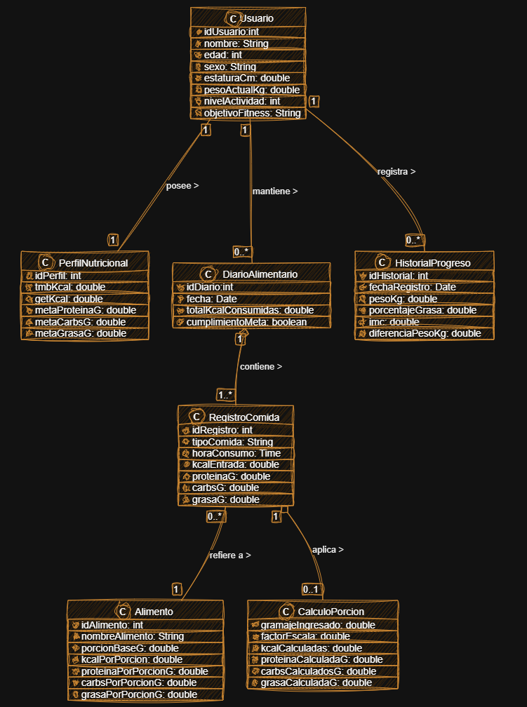

# 09. Modelado y Diagramas UML

Este documento contiene el modelado visual del sistema **Fuely** mediante el **Lenguaje Unificado de Modelado (UML 2.5)**, bajo el marco metodológico del **Proceso Unificado (UP Ágil)**. Incluye el **Modelo de Dominio conceptual** y el **Diagrama de Casos de Uso**.

## 1. Modelo de Dominio

### 1.1 Entidades del Dominio Fuely

| Entidad | Descripción / Concepto de Negocio | Atributos Clave |
| :--- | :--- | :--- |
| **Usuario** | Persona que utiliza la aplicación para gestionar su nutrición. | `idUsuario`, `nombre`, `edad`, `sexo`, `estaturaCm`, `pesoActualKg`, `nivelActividad`, `objetivoFitness` |
| **PerfilNutricional** | Requerimientos calóricos y metas de macronutrientes calculados. | `idPerfil`, `tmbKcal`, `getKcal`, `metaProteinaG`, `metaCarbsG`, `metaGrasaG` |
| **DiarioAlimentario** | Registro diario de consumos acumulados por fecha. | `idDiario`, `fecha`, `totalKcalConsumidas`, `cumplimientoMeta` |
| **RegistroComida** | Entrada individual dentro de un tiempo de comida específico. | `idRegistro`, `tipoComida`, `horaConsumo`, `kcalEntrada`, `proteinaG`, `carbsG`, `grasaG` |
| **Alimento** | Elemento del catálogo nutricional de referencia. | `idAlimento`, `nombreAlimento`, `porcionBaseG`, `kcalPorPorcion`, `proteinaPorPorcionG`, `carbsPorPorcionG`, `grasaPorPorcionG` |
| **CalculoPorcion** | Operación de escalado proporcional por gramaje ingresado. | `gramajeIngresado`, `factorEscala`, `kcalCalculadas`, `proteinaCalculadaG`, `carbsCalculadosG`, `grasaCalculadaG` |
| **HistorialProgreso** | Registro de evolución corporal del usuario a lo largo del tiempo. | `idHistorial`, `fechaRegistro`, `pesoKg`, `porcentajeGrasa`, `imc`, `diferenciaPesoKg` |

---

### 1.2 Relaciones, Multiplicidades y Reglas de Dominio

* **Usuario (1) ──── (1) PerfilNutricional**:
  * **Tipo**: Asociación directa de pertenencia.
  * **Regla**: Cada usuario tiene asignado exactamente un perfil nutricional activo calculado a partir de sus métricas fisiológicas.
* **Usuario (1) ──── (0..*) DiarioAlimentario**:
  * **Tipo**: Asociación estructural.
  * **Regla**: Un usuario registra cero o muchos diarios alimentarios (un diario por cada día calendario).
* **DiarioAlimentario (1) ◆──── (1..*) RegistroComida**:
  * **Tipo**: Composición.
  * **Regla**: Las entradas de comida nacen y mueren con su diario alimentario correspondiente. Si se elimina un diario, sus registros asociados se destruyen.
* **RegistroComida (0..*) ──── (1) Alimento**:
  * **Tipo**: Asociación simple.
  * **Regla**: Cada registro de comida refiere a exactamente un alimento del catálogo base. El alimento subsiste en el catálogo independientemente de si se borran registros de comida.
* **RegistroComida (1) ◇──── (0..1) CalculoPorcion**:
  * **Tipo**: Agregación / Operación del dominio.
  * **Regla**: Un registro de comida aplica un cálculo de porción ajustado por gramaje cuando el consumo no equivale a la porción estándar.
* **Usuario (1) ──── (0..*) HistorialProgreso**:
  * **Tipo**: Asociación histórica.
  * **Regla**: Un usuario acumula múltiples mediciones de peso y progreso corporal en el tiempo.

---

### 1.3 Modelo de Dominio

---

## 2. Diagrama de Casos de Uso

El **Diagrama de Casos de Uso** establece el límite del sistema Fuely, identificando los actores externos y los requerimientos funcionales organizados como objetivos del usuario.

### 2.1 Especificación de Actores y Casos de Uso

* **Límite del Sistema**: `Sistema Fuely`
* **Actores**:
  * **Usuario** (Actor Principal): Interactúa con la aplicación para configurar su perfil, calcular porciones, registrar consumos y monitorear su progreso.
  * **Administrador de Contenido** (Actor Secundario): Gestiona y actualiza la base de datos nutricional de alimentos de referencia.
  * **Base de Datos Nutricional Externa (SMAE/USDA)** (Sistema Externo): Suministra tablas de composición de alimentos predeterminadas.

### 2.2 Relaciones de Inclusión y Extensión

* `CU03 (Registrar Consumo de Alimento en Diario)` **«include»** `CU04 (Calcular Porción por Gramaje)`: La preparación del cálculo de macronutrientes por gramaje es obligatoria para guardar una entrada en el diario.
* `CU05 (Consultar Catálogo Nutricional)` **«extend»** `CU06 (Gestionar Alimentos Personalizados)`: El alta de un nuevo alimento personalizado es un flujo opcional que se activa cuando el usuario no localiza un alimento en el catálogo base.

---

### 2.3 Diagrama de Casos de Uso

